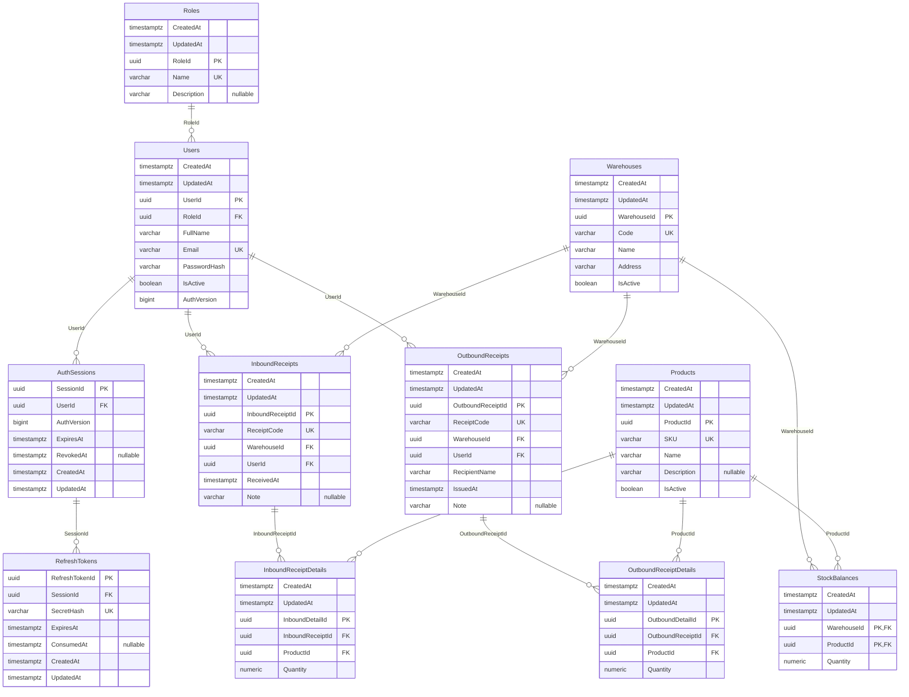

# Mini WMS Database Design

## Scope and implementation status

The source diagram is [`mini_wms_erd.drawio`](../mini_wms_erd.drawio). Its nine tables, 43 business fields, and 18 audit fields are preserved. Authentication adds Users.AuthVersion and two seven-column tables, AuthSessions and RefreshTokens: 11 tables and 76 user-defined columns in total, including 22 audit columns. EF migration history and PostgreSQL system columns are excluded. PostgreSQL is the selected provider; C# models and Fluent API mappings drive EF migrations.

The models exist in [`src/MiniWms.Domain/Entities`](../src/MiniWms.Domain/Entities). [`WmsDbContext`](../src/MiniWms.Infrastructure/Persistence/WmsDbContext.cs) loads the eleven [`IEntityTypeConfiguration` mappings](../src/MiniWms.Infrastructure/Persistence/Configurations) from Infrastructure. Domain has no dependency on EF Core. Keeping mappings outside the entities follows the [official EF Core model configuration guidance](https://learn.microsoft.com/en-us/ef/core/modeling/).

PostgreSQL 18.6 runs locally at `127.0.0.1:5432`; database `mini_wms` has owner `postgres` and UTF8 encoding. The original and audit migrations plus [`20261026170941_AddAuthenticationSessions`](../src/MiniWms.Infrastructure/Persistence/Migrations/20261026170941_AddAuthenticationSessions.cs) are applied. The nine-table development fixture still contains 52 original rows; authentication history is created separately by real login/refresh operations. The API registers a scoped WmsDbContext using ConnectionStrings:WmsDatabase.

The .NET 8.0.426 SDK and EF tooling 8.0.32 support this schema. Model/audit/fixture/adapter checks, isolated Application tests, and API integration tests against real PostgreSQL/Redis now cover authentication. Migration/seed-rerun checksums preserved every original fixture value, including password hashes and audit timestamps. Warehouse business-flow integration tests now verify real PostgreSQL document/stock persistence, rollback, concurrent first inserts, competing issues, and physical-count ordering. See BUSINESS_API.md for the implemented protocol; no additional schema migration is required.

## Local connection and migration workflow

The password-free description of the development connection is `Host=127.0.0.1;Port=5432;Database=mini_wms;Username=postgres`. The working connection is stored outside the repository in Development User Secrets under `UserSecretsId` `MiniWms.Api`; existing Development settings were moved to this store when the workspace was renamed, and no password is committed to source. Api also accepts the `ConnectionStrings__WmsDatabase` environment variable. API startup using User Secrets and HTTP 200 responses from `/` and `/health` were verified; `/health` remains a process-liveness check.

The design-time factory reads `ConnectionStrings__WmsDatabase` directly. If absent, its password-free fallback permits model inspection and migration generation without opening a connection. EF database updates need valid connection credentials; the factory does not read API User Secrets. See the root [README](../README.md) for hidden-prompt environment configuration and explicit `dotnet ef` commands.

Migrations and the model snapshot are stored in `src/MiniWms.Infrastructure/Persistence/Migrations`. `InitialCreate` is preserved; the applied `20261022164820_AddAuditTimestamps` migration adds eighteen required timestamp columns/defaults without changing business data or relationships. When applied to a database with existing rows, migration-time `CURRENT_TIMESTAMP` backfills their audit values because original creation times are unknown. Future installations must apply the committed migrations rather than recreate them. Neither dependency registration nor API startup calls `EnsureCreated`, creates a database, or applies migrations automatically. EF Core tracks applied migrations in `__EFMigrationsHistory`, separately from the nine ERD business tables. The reviewed initial migration creates no user-defined `xmin` column; stock uses PostgreSQL's implicit system column.

## Diagram interpretation

The original draw.io file remains unchanged. Its connector `fk-2` incorrectly connects `InboundReceipts` to `OutboundReceipts`, although the outbound header contains `UserId` and no inbound-receipt foreign key. The model therefore maps `OutboundReceipts.UserId` to `Users.UserId`. The diagram also repeats the `Users` to `InboundReceipts` connector; the model contains that relationship once.

There are 13 required foreign-key relationships: the original 11 plus AuthSessions.UserId and RefreshTokens.SessionId. Inbound and outbound documents remain independent, and StockBalances retains its composite key. Durable SQL authentication records preserve refresh rotation/revocation history; Redis separately holds the currently accepted login session. No stock-adjustment-history table is introduced.

## Shared mapping conventions

- Table and column names retain the ERD's PascalCase spelling, including `SKU`. PostgreSQL SQL written by hand must quote these identifiers, for example `"StockBalances"` and `"WarehouseId"`.
- All ID and FK properties are C# `Guid` mapped to PostgreSQL `uuid`. Each single-column primary key is initialized with `Guid.NewGuid()` and configured with `ValueGeneratedNever()`. There is no database UUID default or required UUID extension. The stock composite key is supplied from its warehouse and product references.
- All fields are required unless explicitly marked nullable below. Required strings have C# `string.Empty` initializers; the mapping rejects SQL `NULL`, but does not yet reject empty or whitespace-only input. Future request/domain validation must do so.
- Reference navigation properties are nullable in C# because the related object may not have been loaded. All FK scalar properties remain nonnullable `Guid`, and all 13 relationships are explicitly required in Fluent API. An unloaded navigation therefore does not make its database relationship optional. Collection navigations are initialized empty.
- `IsActive` is C# `bool`, mapped to `boolean`, and initialized to `true` in C#. No SQL default is configured.
- Quantities are C# `decimal` mapped to `numeric(18,3)`: one product's fixed stock unit, supporting thousandths. No unit conversion is modeled. The maximum supported quantity is `999999999999999.999`. Movement quantities must be positive; stock and physical counts must be nonnegative. Future input validation must reject values with more than three fractional digits rather than relying on database rounding, and must check aggregate totals for overflow.
- `ReceivedAt` and `IssuedAt` are caller-supplied C# `DateTimeOffset` values mapped to `timestamp with time zone`. There is no automatic current-time default. Future use cases must normalize them to UTC with offset zero before persistence. PostgreSQL stores an instant rather than the original timezone, and Npgsql requires offset zero for this mapping. See [Npgsql date/time handling](https://www.npgsql.org/doc/types/datetime.html).
- Every entity implements the Domain-only `IAuditableEntity` interface. `CreatedAt` and `UpdatedAt` are concrete properties on each separate entity type, not a mapped inheritance hierarchy. `WmsDbContext` configures them consistently after applying entity configurations.

## Complete data dictionary

`PK` means primary key, `FK` means required foreign key, and `UK` means a configured unique index. All FKs use restricted deletion. The per-table sections retain the original 43 business fields. Each table also contains the two columns in the shared audit dictionary below, with Users.AuthVersion and the two authentication tables bringing the complete model to 76 user-defined columns. Navigation properties are relationships and do not create additional columns.

### Common audit columns on all eleven tables

| Column | PostgreSQL type | Nullable | Key or rule |
| --- | --- | --- | --- |
| CreatedAt | `timestamp with time zone` | No | UTC creation instant; insert/backfill default `CURRENT_TIMESTAMP`; preserved on tracked updates. |
| UpdatedAt | `timestamp with time zone` | No | UTC last-update instant; insert/backfill default `CURRENT_TIMESTAMP`; refreshed on tracked updates. |

Both map to C# `DateTimeOffset`. `SaveChanges` and `SaveChangesAsync` detect changes and assign one UTC instant to both fields for added entities, overriding caller-supplied audit values. Modified entities retain their original `CreatedAt`, which is excluded from the update, and receive the current UTC `UpdatedAt`. Unchanged and deleted entries are unaffected. The context accepts an optional `TimeProvider`, using `TimeProvider.System` by default.

Database defaults support inserts that omit audit fields and backfill existing rows when the audit migration is applied. They do not automatically refresh `UpdatedAt` on SQL updates. There is no update trigger: direct SQL and `ExecuteUpdate` bypass context auditing and must maintain `UpdatedAt` explicitly. Backfilled dates represent the migration instant, not an invented historical creation time.

### Roles — 3 fields

| Column | PostgreSQL type | Nullable | Key or rule |
| --- | --- | --- | --- |
| RoleId | `uuid` | No | PK; client-generated GUID. |
| Name | `varchar(50)` | No | UK; intended roles are `Admin` and `Staff`. |
| Description | `varchar(2000)` | Yes | Optional role description. |

### Users - six ERD fields plus authentication version

| Column | PostgreSQL type | Nullable | Key or rule |
| --- | --- | --- | --- |
| UserId | `uuid` | No | PK; client-generated GUID. |
| RoleId | `uuid` | No | FK to `Roles.RoleId`. |
| FullName | `varchar(200)` | No | User's full name. |
| Email | `varchar(254)` | No | UK; see normalization policy below. |
| PasswordHash | `varchar(1024)` | No | Password hash only; development seeding uses ASP.NET Core Identity's password hasher. |
| IsActive | `boolean` | No | Account active status; C# default `true`. |
| AuthVersion | `bigint` | No | Default 0; nonnegative check and EF concurrency token. Advances on session replacement/revocation and account-state changes. |

### Products — 5 fields

| Column | PostgreSQL type | Nullable | Key or rule |
| --- | --- | --- | --- |
| ProductId | `uuid` | No | PK; client-generated GUID. |
| SKU | `varchar(64)` | No | UK; product code. |
| Name | `varchar(200)` | No | Product name. |
| Description | `varchar(2000)` | Yes | Optional product description. |
| IsActive | `boolean` | No | Whether the product is offered; C# default `true`. |

### Warehouses — 5 fields

| Column | PostgreSQL type | Nullable | Key or rule |
| --- | --- | --- | --- |
| WarehouseId | `uuid` | No | PK; client-generated GUID. |
| Code | `varchar(64)` | No | UK; warehouse code. |
| Name | `varchar(200)` | No | Warehouse name. |
| Address | `varchar(500)` | No | Warehouse address. |
| IsActive | `boolean` | No | Warehouse active status; C# default `true`. |

### StockBalances — 3 fields

| Column | PostgreSQL type | Nullable | Key or rule |
| --- | --- | --- | --- |
| WarehouseId | `uuid` | No | First composite-PK member; FK to `Warehouses.WarehouseId`. |
| ProductId | `uuid` | No | Second composite-PK member; FK to `Products.ProductId`; lookup index. |
| Quantity | `numeric(18,3)` | No | Check: `"Quantity" >= 0`. |

### InboundReceipts — 6 fields

| Column | PostgreSQL type | Nullable | Key or rule |
| --- | --- | --- | --- |
| InboundReceiptId | `uuid` | No | PK; client-generated GUID. |
| ReceiptCode | `varchar(64)` | No | UK within `InboundReceipts`. |
| WarehouseId | `uuid` | No | FK to `Warehouses.WarehouseId`. |
| UserId | `uuid` | No | FK to `Users.UserId`; document creator. |
| ReceivedAt | `timestamp with time zone` | No | Receipt instant; UTC offset zero required. |
| Note | `varchar(2000)` | Yes | Optional document note. |

### InboundReceiptDetails — 4 fields

| Column | PostgreSQL type | Nullable | Key or rule |
| --- | --- | --- | --- |
| InboundDetailId | `uuid` | No | PK; client-generated GUID. |
| InboundReceiptId | `uuid` | No | FK to `InboundReceipts.InboundReceiptId`; first member of composite UK. |
| ProductId | `uuid` | No | FK to `Products.ProductId`; second member of composite UK. |
| Quantity | `numeric(18,3)` | No | Check: `"Quantity" > 0`. |

### OutboundReceipts — 7 fields

| Column | PostgreSQL type | Nullable | Key or rule |
| --- | --- | --- | --- |
| OutboundReceiptId | `uuid` | No | PK; client-generated GUID. |
| ReceiptCode | `varchar(64)` | No | UK within `OutboundReceipts`. |
| WarehouseId | `uuid` | No | FK to `Warehouses.WarehouseId`. |
| UserId | `uuid` | No | FK to `Users.UserId`; document creator. |
| RecipientName | `varchar(200)` | No | Recipient person or organization. |
| IssuedAt | `timestamp with time zone` | No | Issue instant; UTC offset zero required. |
| Note | `varchar(2000)` | Yes | Optional document note. |

### OutboundReceiptDetails — 4 fields

| Column | PostgreSQL type | Nullable | Key or rule |
| --- | --- | --- | --- |
| OutboundDetailId | `uuid` | No | PK; client-generated GUID. |
| OutboundReceiptId | `uuid` | No | FK to `OutboundReceipts.OutboundReceiptId`; first member of composite UK. |
| ProductId | `uuid` | No | FK to `Products.ProductId`; second member of composite UK. |
| Quantity | `numeric(18,3)` | No | Check: `"Quantity" > 0`. |

## Durable authentication tables

AuthSession and RefreshToken each include the two shared audit columns. They supplement the original drawing rather than changing its warehouse entities.

### AuthSessions - five authentication fields

| Column | PostgreSQL type | Nullable | Key or rule |
| --- | --- | --- | --- |
| SessionId | `uuid` | No | PK; application-generated session identifier. |
| UserId | `uuid` | No | Restricted FK to Users.UserId. |
| AuthVersion | `bigint` | No | Positive generation captured when login succeeds. |
| ExpiresAt | `timestamp with time zone` | No | Original absolute session deadline; refresh never extends it. |
| RevokedAt | `timestamp with time zone` | Yes | Durable session revocation instant. |

### RefreshTokens - five authentication fields

| Column | PostgreSQL type | Nullable | Key or rule |
| --- | --- | --- | --- |
| RefreshTokenId | `uuid` | No | PK; public lookup selector, not an authentication secret. |
| SessionId | `uuid` | No | Restricted FK to AuthSessions.SessionId. |
| SecretHash | `varchar(64)` | No | Unique uppercase SHA-256 verifier hash; format checked by PostgreSQL. |
| ExpiresAt | `timestamp with time zone` | No | Matches the owning session deadline. |
| ConsumedAt | `timestamp with time zone` | Yes | Set atomically when rotation consumes the token; retained for replay detection. |

Authentication state changes lock Users rows with FOR UPDATE and a five-second lock timeout. Earlier unrevoked sessions are updated/flushed before inserting a new session within the same transaction, respecting the filtered unique index. Consuming a refresh token and inserting its successor commit together in PostgreSQL. Account IsActive/AuthVersion checks remain authoritative if Redis cleanup fails. See [authentication design](AUTHENTICATION.md) for cross-store failure handling and request boundaries.

## Constraints, indexes, and deletion

The configured model includes the following indexes in addition to each table's primary key:

| Table | Columns | Unique | Purpose |
| --- | --- | --- | --- |
| AuthSessions | `UserId` | Yes | One unrevoked row per user; filter RevokedAt IS NULL. |
| AuthSessions | `UserId, AuthVersion` | Yes | One durable session per account generation. |
| RefreshTokens | `SecretHash` | Yes | Unique refresh verifier hash. |
| RefreshTokens | `SessionId` | No | Session history/FK lookup. |
| Roles | `Name` | Yes | Prevent duplicate role names. |
| Users | `Email` | Yes | Prevent duplicate stored email values. |
| Users | `RoleId` | No | FK lookup, supplied by EF Core convention. |
| Products | `SKU` | Yes | Product-code lookup and uniqueness. |
| Warehouses | `Code` | Yes | Warehouse-code lookup and uniqueness. |
| StockBalances | `ProductId` | No | Inventory lookup across warehouses for one product. |
| InboundReceipts | `ReceiptCode` | Yes | Document lookup and uniqueness within inbound receipts. |
| InboundReceipts | `WarehouseId, ReceivedAt` | No | Warehouse receipt history by date; also covers the warehouse FK. |
| InboundReceipts | `UserId` | No | Creator FK lookup, supplied by EF Core convention. |
| OutboundReceipts | `ReceiptCode` | Yes | Document lookup and uniqueness within outbound receipts. |
| OutboundReceipts | `WarehouseId, IssuedAt` | No | Warehouse issue history by date; also covers the warehouse FK. |
| OutboundReceipts | `UserId` | No | Creator FK lookup, supplied by EF Core convention. |
| InboundReceiptDetails | `InboundReceiptId, ProductId` | Yes | One line per product per inbound receipt; also covers the header FK. |
| InboundReceiptDetails | `ProductId` | No | Product FK lookup, supplied by EF Core convention. |
| OutboundReceiptDetails | `OutboundReceiptId, ProductId` | Yes | One line per product per outbound receipt; also covers the header FK. |
| OutboundReceiptDetails | `ProductId` | No | Product FK lookup, supplied by EF Core convention. |

The `StockBalances` primary key `(WarehouseId, ProductId)` gives one balance per pair and supports exact-pair and warehouse-prefix lookups. There is no redundant synthetic stock ID. The reverse `ProductId` index supports product-only inventory queries. Index definitions and generated SQL were reviewed in the initial migration and verified against PostgreSQL.

Three inventory checks are configured (authentication adds separate version/hash checks): `CK_StockBalances_Quantity_NonNegative`, `CK_InboundReceiptDetails_Quantity_Positive`, and `CK_OutboundReceiptDetails_Quantity_Positive`. Both detail tables reject repeated products through their composite unique indexes; request validation rejects duplicates before opening a stock transaction and requires 1 to 100 nonnull lines, which the FK/unique constraints alone do not enforce.

All 13 relationships use `DeleteBehavior.Restrict`, including header-to-detail relationships. Deleting a referenced role, user, product, warehouse, or populated receipt must fail rather than silently deleting history. There is no delete use case in this scope. Products, warehouses, and users retain their `IsActive` flags for deactivation. These flags do not enforce business rules by themselves.

## Normalization and document numbering

Current unique indexes apply to the stored string values. No `citext`, case-insensitive collation, functional index, normalized shadow field, or value converter is configured. Under the intended ordinary PostgreSQL string comparison, the mappings do not guarantee case-insensitive uniqueness: values such as `person@example.com` and `PERSON@example.com` can coexist if written without normalization.

Login and Staff creation trim/lowercase email. Product SKUs, warehouse codes, and receipt codes are trimmed and invariant-uppercase, restricted to ASCII letters/digits/dots/underscores/hyphens with maximum length 64. Creation checks existing case variants; exact database unique constraints handle concurrent canonical API writes. Direct SQL/import writers must follow the same normalization. Roles remain canonical Admin/Staff.

Each inbound ReceiptCode is unique across all inbound receipts and warehouses; each outbound ReceiptCode is unique across all outbound receipts and warehouses. The two document types may share a code. Clients provide document codes; no automatic sequence is introduced. Conflicting codes return 409 and roll back all stock changes.

## Stock transactions and concurrency

StockBalanceConfiguration retains the EF-only uint Version shadow concurrency token mapped to PostgreSQL's implicit xmin system column. It does not add a business column or entity. The primary concurrency protocol is implemented by PostgresWarehouseStore: a read-committed transaction locks the existing Warehouses row FOR UPDATE before stock reads, referenced Products rows FOR SHARE in ID order, and existing StockBalances rows FOR UPDATE in ID order.

Receipts, issues, and absolute physical-count adjustments follow the same lock protocol across API instances. Serializing writes per warehouse protects missing-pair creation as well as existing balances; different warehouses can proceed concurrently. Product/warehouse active state and all line quantities are checked inside the transaction. A header, all details, and every stock update commit together or roll back together. The creator comes from the current authenticated account. No negative balance or numeric overflow is accepted.

The five-second lock timeout, deadlock/serialization conflicts, and xmin conflicts map to 409 after rollback. There is no automatic internal retry; callers retry the complete request. Duplicate document codes also return 409 without reapplying stock. Physical counts overwrite all movements ordered before them and precede all movements ordered after them. External writers must honor this protocol. See [BUSINESS_API.md](BUSINESS_API.md) and [PostgreSQL locking](https://www.postgresql.org/docs/18/explicit-locking.html).

Real-provider API tests verify complete issue persistence, late-line rollback, precision and reference validation, cross-host concurrent first receipts, oversell protection, duplicate document codes across warehouses, zero/fractional counts, capacity overflow, and count/movement ordering. PostgreSQL remains the inventory source of truth; Redis only holds authentication sessions. Counts update balance audit timestamps and structured application logs; there is no durable adjustment ledger, so document movements alone do not reconstruct inventory after counts.

## Development mock data

The explicit Api `--seed-mock-data` command is restricted to `Development` and exits after seeding. It does not run at ordinary API startup or apply migrations. See the root [README](../README.md) for execution and secret configuration. The fixture has been applied to local `mini_wms`, with 52 rows in total.

Fixtures provide two roles; four users (exactly one Admin and three Staff, including one inactive); ten products (two inactive); three warehouses (one inactive); three inbound documents/twelve lines; two outbound documents/six lines; and ten warehouse/product stock pairs. Balances are calculated from the supplied movements, include fractional and zero quantities, and are all nonnegative. Documents involve active warehouses/products and active Staff. The inactive fixtures support later validation tests without creating invalid movement history.

User emails are `admin@mini-wms.test`, `staff1@mini-wms.test`, `staff2@mini-wms.test`, and `staff.banned@mini-wms.test`. The Admin password and shared initial Staff password come from `MockData:AdminPassword` and `MockData:StaffPassword` configuration. The local initial values were generated using a cryptographically secure random source and saved in Development User Secrets. ASP.NET Core Identity's password hasher generates salted hashes; plaintext passwords are not included in source or documentation. These accounts are now usable through POST /auth/login; the inactive Staff account is denied. Local helper scripts retrieve the configured initial credential without committing it to source.

The guarded seeder requires a fresh context, uses one transaction with a transaction-scoped advisory lock, and locks all nine tables against concurrent writes while checking/inserting fixtures. An empty database is accepted, including optional preexisting roles named exactly `Admin` and/or `Staff`. A complete matching fixture is recognized through table counts, keys, and identifying values and skipped on rerun, without resetting passwords, audit timestamps, quantities, or other edits. Partial, conflicting, or unrelated data are refused; existing rows are never deleted or overwritten. This controlled seed transaction is separate from the runtime warehouse-lock protocol. After new API business data are added, the strict fixture recognizer may refuse reseeding; it never clears or resets existing business data.

Live PostgreSQL verification confirmed all fixture counts, exactly one Admin, four Identity password hashes, valid and equal initial `CreatedAt`/`UpdatedAt` values on all 52 rows, and every stock balance matching inbound-minus-outbound movements with no negative quantities. A rerun reported the complete fixture already present; persisted-value checksums were identical before and after, including hashes and timestamps. Running the compiled seed command in Production mode was also verified to fail before database access.
